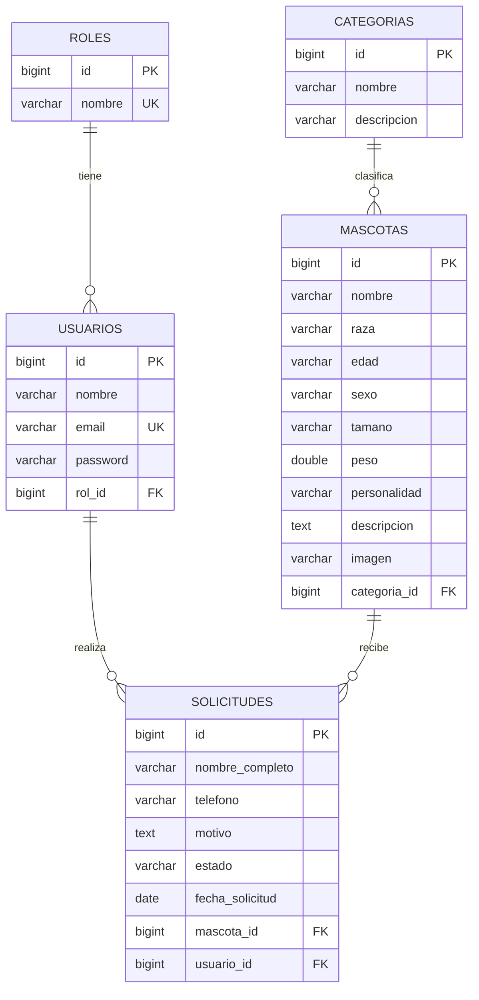

# Modelo Entidad-Relación – Patitas Felices (Entrega 3)

Base de datos: `db_patitas_felices` (MySQL) · 5 tablas relacionadas.

## Diagrama (Mermaid – se visualiza directamente en GitHub)



## Esquema simplificado

```
ROL 1 ──── N USUARIO 1 ──── N SOLICITUD N ──── 1 MASCOTA N ──── 1 CATEGORIA
```

## Tablas, claves y relaciones

| Tabla | Clave primaria | Claves foráneas | Relación |
|---|---|---|---|
| `roles` | `id` | – | 1 rol → N usuarios |
| `usuarios` | `id` | `rol_id → roles.id` | N usuarios → 1 rol · 1 usuario → N solicitudes |
| `categorias` | `id` | – | 1 categoría → N mascotas |
| `mascotas` | `id` | `categoria_id → categorias.id` | N mascotas → 1 categoría · 1 mascota → N solicitudes |
| `solicitudes` | `id` | `mascota_id → mascotas.id`, `usuario_id → usuarios.id` | N solicitudes → 1 mascota · N solicitudes → 1 usuario |

## Reglas de integridad

- Eliminar una **categoría** con mascotas está bloqueado (la app muestra un mensaje); ya no borra las mascotas en cascada.
- Eliminar una **mascota** elimina sus solicitudes (`ON DELETE CASCADE`).
- Eliminar un **usuario** deja sus solicitudes sin dueño (`usuario_id = NULL`).
- `usuarios.email` y `roles.nombre` son únicos.

## Validaciones (Bean Validation / Spring Validator)

| Entidad | Campo | Regla |
|---|---|---|
| Usuario | nombre | `@NotBlank`, `@Size(3–100)` |
| Usuario | email | `@NotBlank`, `@Email`, único (validado en controlador) |
| Usuario | password | `@Pattern` 6–60 caracteres (obligatoria al crear) |
| Categoria | nombre | `@NotBlank`, `@Size(3–50)` |
| Mascota | nombre / raza / edad / tamaño | `@NotBlank` + `@Size` |
| Mascota | sexo | `@NotBlank`, `@Pattern(Macho\|Hembra)` |
| Mascota | peso | `@NotNull`, `@DecimalMin(0.1)`, `@DecimalMax(120)` (valor numérico) |
| Mascota | descripcion | `@NotBlank`, `@Size(10–1000)` |
| Mascota | categoria | obligatoria |
| Solicitud | nombreCompleto | `@NotBlank`, `@Size(3–100)` |
| Solicitud | telefono | `@NotBlank`, `@Pattern(\d{9})` (numérico) |
| Solicitud | motivo | `@NotBlank`, `@Size(10–500)` |
